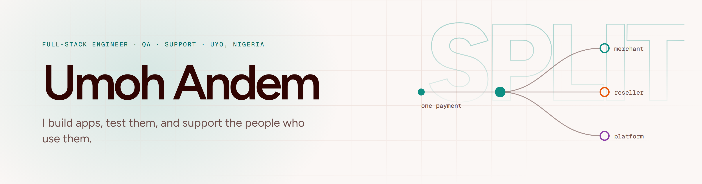

<picture>
  <source media="(prefers-color-scheme: dark)" srcset="assets/banner-dark.png" />
  
</picture>

I'm a full-stack developer in Uyo, Nigeria, and I run [Kobo & Code](https://umoh.name.ng), a small studio that makes careful software for the way Nigeria works. Lately that means payments: split payments, webhooks, and the documentation that makes them easy to get right.

## What I'm working on

**[`@umohpyro/better-auth-nuvion`](https://www.npmjs.com/package/@umohpyro/better-auth-nuvion)** is a [Better Auth](https://better-auth.com) plugin for [Nuvion](https://nuvion.co). A customer pays a merchant once, and the plugin moves each parent's share up the chain: a platform, a reseller, a merchant. It also covers refunds, retries and withdrawals. It is an independent beta, not an official Nuvion product, and the docs say exactly what has and has not been run against Nuvion.

- [Read the docs](https://docs.better-auth-nuvion.umoh.name.ng)
- [Try the live example](https://better-auth-nuvion-example.umoh.name.ng), with your own Nuvion sandbox key ([source](https://github.com/umohpyro/better-auth-nuvion-example))

## Examples I've built on the Nuvion sandbox

Each one is a small, complete app you can read and run. They use a sandbox, so no real money moves.

| App                                                            | What it shows                                                                  |
| -------------------------------------------------------------- | ------------------------------------------------------------------------------ |
| [Mercato](https://mercato.umoh.name.ng) ([source][mercato])    | Every way of sending money within Nuvion, one scenario at a time               |
| [Hookline](https://hooks.umoh.name.ng) ([source][hookline])    | Register, test, inspect and verify a webhook                                   |
| [Treasury](https://treasury.umoh.name.ng) ([source][treasury]) | Holding stablecoin, a deposit address per network, and converting with a quote |
| [Remit](https://remit.umoh.name.ng) ([source][remit])          | Sending money home across currencies, with a quote and delivery tracking       |
| [Payroll](https://payroll.umoh.name.ng) ([source][payroll])    | Paying contractors abroad: FX quotes, batch payments and a timeline            |

[mercato]: https://github.com/umohpyro/nuvion-move-funds-nextjs
[hookline]: https://github.com/umohpyro/nuvion-webhook-inspector
[treasury]: https://github.com/umohpyro/nuvion-stablecoin-example
[remit]: https://github.com/umohpyro/nuvion-remittance-example
[payroll]: https://github.com/umohpyro/nuvion-payroll-example

## Earlier

- [DietGPT](https://diet-gpt-alx-project.vercel.app): a diet bot that speaks Pidgin ([source](https://github.com/umohpyro/DietGPT)), built during my Software Engineering programme at ALX.

## What I work with

TypeScript, Next.js, Node.js, Prisma, Better Auth, PostgreSQL and MySQL, Redis. Also Java, WordPress, and the server side of hosting (WHM and cPanel).

## Find me

[LinkedIn](https://linkedin.com/in/umohpyro) · [Medium](https://medium.com/umohpyro) · [X](https://twitter.com/umohpyro) · [andemumoh@gmail.com](mailto:andemumoh@gmail.com)
