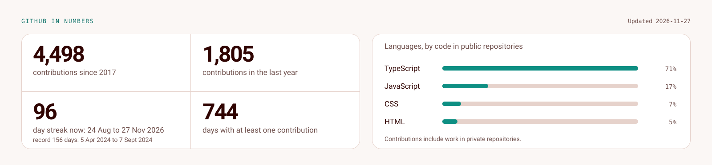

<picture>
  <source media="(prefers-color-scheme: dark)" srcset="assets/banner-teal-dark.png" />
  
</picture>

I'm a full-stack software engineer, a QA and a support engineer in Uyo, Nigeria. I run [Kobo & Code](https://umoh.name.ng), a small studio that makes careful software for the way Nigeria works: apps that count every kobo, run on the phones people carry, and say plainly what they do with your data.

## Products

| Product                                         | What it is                                                                           |
| ----------------------------------------------- | ------------------------------------------------------------------------------------ |
| [Ajo Ledger](https://ajo.umoh.name.ng)          | Android record book for ajo, esusu and adashe savings groups. Records only, offline  |
| [Lumen Cycle](https://lumen.umoh.name.ng)       | Android period and cycle tracker. Everything stays on the phone, no account          |
| [Solar Sales](https://solar-crm.umoh.name.ng)   | WhatsApp sales console for solar businesses: one shared inbox, quotes and follow-ups |
| [RenewalDesk](https://renewaldesk.umoh.name.ng) | Android renewals and collections desk for agencies billing clients in naira          |

## Payments work

**[`@umohpyro/better-auth-nuvion`](https://www.npmjs.com/package/@umohpyro/better-auth-nuvion)** is a [Better Auth](https://better-auth.com) plugin for [Nuvion](https://nuvion.co). A customer pays a merchant once, and the plugin moves each parent's share up the chain: a platform, a reseller, a merchant. It also covers refunds, retries and withdrawals. It is an independent beta, not an official Nuvion product, and the docs say exactly what has and has not been run against Nuvion.

- [Read the docs](https://docs.better-auth-nuvion.umoh.name.ng)
- [Try the live example](https://better-auth-nuvion-example.umoh.name.ng), with your own Nuvion sandbox key ([source](https://github.com/umohpyro/better-auth-nuvion-example))
- Start from a [Next.js starter](https://github.com/umohpyro/better-auth-nuvion-starter) ([live](https://better-auth-nuvion-starter.vercel.app), with your own sandbox key) or a [TanStack Start starter](https://github.com/umohpyro/better-auth-nuvion-tanstack-starter): the smallest useful app on each, MIT licensed

Small apps I've built on the Nuvion sandbox, each one complete enough to read and run (no real money moves):

| App                                                            | What it shows                                                                  |
| -------------------------------------------------------------- | ------------------------------------------------------------------------------ |
| [Mercato](https://mercato.umoh.name.ng) ([source][mercato])    | Every way of sending money within Nuvion, one scenario at a time               |
| [Hookline](https://hooks.umoh.name.ng) ([source][hookline])    | Register, test, inspect and verify a webhook                                   |
| [Treasury](https://treasury.umoh.name.ng) ([source][treasury]) | Holding stablecoin, a deposit address per network, and converting with a quote |
| [Remit](https://remit.umoh.name.ng) ([source][remit])          | Sending money home across currencies, with a quote and delivery tracking       |
| [Payroll](https://payroll.umoh.name.ng) ([source][payroll])    | Paying contractors abroad: FX quotes, batch payments and a timeline            |

[mercato]: https://github.com/umohpyro/nuvion-move-funds-nextjs
[hookline]: https://github.com/umohpyro/nuvion-webhook-inspector
[treasury]: https://github.com/umohpyro/nuvion-stablecoin-example
[remit]: https://github.com/umohpyro/nuvion-remittance-example
[payroll]: https://github.com/umohpyro/nuvion-payroll-example

Also built on the Nuvion sandbox, with the source kept private for now (the live ones take your own sandbox key):

- A **reference app** for building on the Nuvion API with Next.js 16, shadcn/ui, Prisma and SQLite.
- A **[virtual card issuing](https://cards.umoh.name.ng)** example: issue and manage cards. Live, with your own sandbox key.
- A **[marketplace](https://craftline.umoh.name.ng)** example (Craftline): one card payment split between sellers and the platform. Live, with your own sandbox key.
- A **[Hookbox](https://hook.umoh.name.ng)** webhook inbox for testing: catch every delivery, check its signature, replay it, and set the response to test retries. Live, with no account and no key; deliveries are deleted after 7 days.

## Earlier

- [DietGPT](https://diet-gpt-alx-project.vercel.app): a diet bot that speaks Pidgin ([source](https://github.com/umohpyro/DietGPT)), built during my Software Engineering programme at ALX.

## What I work with

- **Build:** TypeScript, Next.js, React Native and Expo, Node.js, Prisma, Better Auth, PostgreSQL and MySQL, Redis, Cloudflare, the WhatsApp Cloud API.
- **Test:** automated browser and API tests with Playwright, and manual testing on the mid-range Android phones people actually carry.
- **Support:** reading a failing payment or webhook until I can say why, and writing it down so the next person doesn't have to.

## GitHub in numbers

<picture>
  <source media="(prefers-color-scheme: dark)" srcset="assets/stats-dark.svg" />
  
</picture>

Most of my work is in private repositories, so the public graph understates it. The card refreshes four times a day and counts private contributions as totals only.

## Find me

[LinkedIn](https://linkedin.com/in/umohpyro) · [Medium](https://medium.com/umohpyro) · [X](https://twitter.com/umohpyro) · [hello@umoh.name.ng](mailto:hello@umoh.name.ng)
